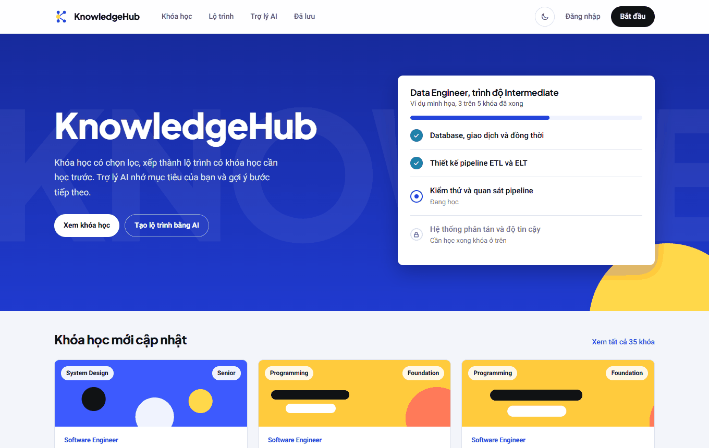
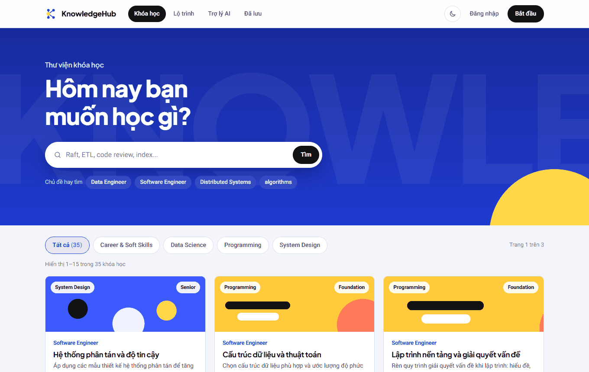
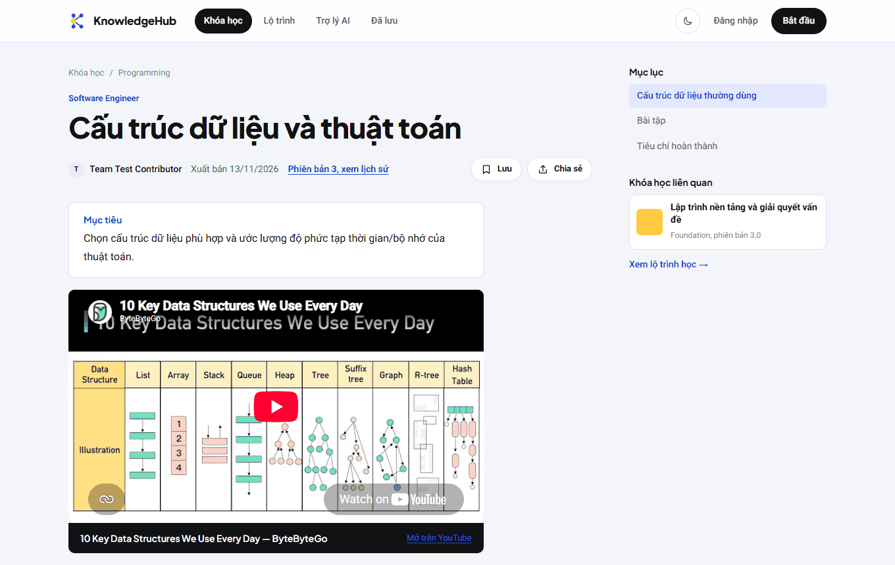

<div align="center">

<picture>
  <source media="(prefers-color-scheme: dark)" srcset="docs/assets/logo-knowledgehub-ngang-toi.svg">
  
</picture>

**Curated learning platform with an AI learning companion.**

[Quick Start](#quick-start) · [Documentation](#documentation) · [Project Structure](#project-structure) · [Contributing](#contributing)


<br><br>



<br>

<table>
  <tr>
    <td></td>
    <td></td>
  </tr>
</table>

</div>

## About

KnowledgeHub is operated by an internal content team. Contributors create and publish courses; Users discover, enroll, and learn; Admins manage the platform. An AI learning companion helps Users plan and follow their path.

## Features

- Course library with search, topic filters and course pages
- Learning roadmaps, including roadmaps drafted by the AI companion
- AI learning companion that remembers a User's goals
- Saved courses for each User
- Studio for Contributors: course editor with local draft recovery, publishing, archiving and version history
- Admin area for users, roles, categories and tags

## Stack

| Layer | Technology |
|---|---|
| Frontend | Next.js / React |
| Backend | Laravel 11 REST API |
| Database | Supabase PostgreSQL (shared development); disposable Docker PostgreSQL (tests) |
| AI Service | Python + FastAPI (future) |
| File Storage | Amazon S3 (future) |
| Dev Environment | Docker Compose |

## Quick Start

Follow [`docs/DEV_CHEATSHEET.md`](docs/DEV_CHEATSHEET.md) to configure private
environment values and start the application. The shared database contains team
data: do not run migrations, seeders, resets, or automated tests against it.

## Documentation

**For developers**

| Document | Description |
|---|---|
| [`docs/PROJECT-ARCHITECTURE.md`](docs/PROJECT-ARCHITECTURE.md) | Concise project architecture and implementation status |
| [`docs/DEV_CHEATSHEET.md`](docs/DEV_CHEATSHEET.md) | Current development setup guide |
| [`docs/ARCHITECTURE.md`](docs/ARCHITECTURE.md) | System architecture, components, domain boundaries |
| [`docs/DEPLOYMENT.md`](docs/DEPLOYMENT.md) | Deployment guide and production checklist |
| [`docs/DATABASE.md`](docs/DATABASE.md) | Schema design, constraints, deletion policies |
| [`docs/ERD.md`](docs/ERD.md) | Entity-relationship diagrams by domain |
| [`docs/API.md`](docs/API.md) | API contract reference (contract-first boundary) |

**For AI agents**

| Document | Description |
|---|---|
| [`AGENTS.md`](AGENTS.md) | Global AI agent constitution (start here) |
| [`backend/AGENTS.md`](backend/AGENTS.md) | Backend-specific agent rules |
| [`skills/`](skills/) | Specialized skills for database and data engineering tasks |

**For team collaboration**

| Document | Description |
|---|---|
| [`docs/team/OWNERSHIP.md`](docs/team/OWNERSHIP.md) | Domain ownership with allowed and forbidden paths |
| [`docs/team/WORKFLOW.md`](docs/team/WORKFLOW.md) | Git workflow, PR rules, hotspot inventory |
| [`docs/team/FEATURES.md`](docs/team/FEATURES.md) | Feature registry by domain |
| [`docs/team/TASK_TEMPLATE.md`](docs/team/TASK_TEMPLATE.md) | Task template for AI agents |
| [`docs/decisions/`](docs/decisions/) | Architecture decision records (ADRs) |

## Design

The interface follows the mockup in [`docs/ui-redesign/mockup/index.html`](docs/ui-redesign/mockup/index.html), in light and dark mode. Headings use Plus Jakarta Sans and body text uses Roboto. The palette is cobalt `#2443E0`, hero blue `#1F3ACF`, accent yellow `#FFD84A` and ink `#101214`; the full set of tokens lives in [`frontend/src/app/globals.css`](frontend/src/app/globals.css).

Handoff notes: [`TAI-LIEU-BAN-GIAO-GIAO-DIEN.md`](docs/ui-redesign/TAI-LIEU-BAN-GIAO-GIAO-DIEN.md) (Vietnamese). UI rules for contributors: [`CLAUDE.md`](CLAUDE.md).

## Development

```bash
# Shell into app container
docker compose exec app sh

# Read-only check of the shared database through the API
curl -f http://localhost:8080/api/v1/categories
```

For isolated tests, follow [`docs/AGENT_RUNBOOK.md`](docs/AGENT_RUNBOOK.md).
The `test-db` service is disposable and is not the shared development database.

## Project Structure

```
knowledgehub/
├── AGENTS.md             # Global AI agent constitution
├── backend/              # Laravel 11 REST API
│   └── AGENTS.md         # Backend-specific agent rules
├── frontend/             # Next.js application
├── ai-service/           # Python AI service
├── database/             # Database files (mounted into container)
│   ├── migrations/       # Schema migrations
│   ├── seeders/          # Development data
│   └── manual/           # Manual SQL scripts
├── docs/                 # Technical documentation
│   ├── ARCHITECTURE.md   # System architecture (implemented + planned)
│   ├── API.md            # API contract reference
│   ├── DATABASE.md       # Schema reference
│   ├── ERD.md            # Entity relationships
│   ├── SETUP.md          # Setup guide
│   ├── validation_tests.sql
│   ├── decisions/        # Architecture decision records (ADRs)
│   ├── team/             # Team collaboration docs
│   └── ui-redesign/      # Interface mockup, logo and handoff notes
├── skills/               # AI agent skills for DB/data work
├── scripts/              # Helper scripts for agent workflow
│   ├── agent-start-task.ps1
│   ├── agent-finish-task.ps1
│   └── create-pr.ps1
└── docker/               # Container configuration
```

## Contributing

1. Read [`docs/DEV_CHEATSHEET.md`](docs/DEV_CHEATSHEET.md) for environment setup
2. Review [`AGENTS.md`](AGENTS.md) if using AI coding assistants
3. Check [`docs/DATABASE.md`](docs/DATABASE.md) for schema conventions
4. Create a task branch from `dev` (never work directly on `main` or `dev`)
5. Make changes with tests and documentation updates
6. Submit pull request with clear description

## License

TBD
