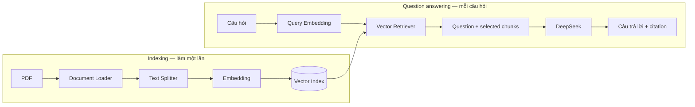
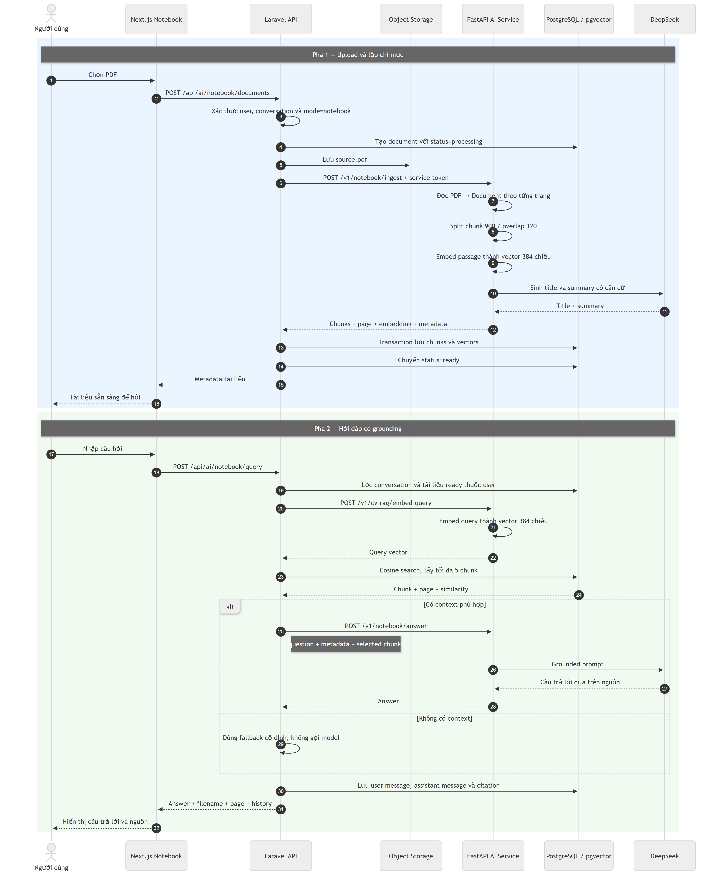

# Seminar AI-04 — Notebook Mini-RAG

## 1. Thông tin buổi trình bày

- **Chủ đề:** Xây dựng luồng hỏi đáp trên một tài liệu cụ thể với LangChain và FastAPI.
- **Đối tượng:** Người mới học AI, biết Python ở mức cơ bản.
- **Thời lượng:** 20 phút, trong đó demo chức năng Notebook chiếm 5 phút.
- **Mục tiêu:** Giúp người nghe hiểu một PDF được biến thành nguồn dữ liệu có thể hỏi đáp như thế nào.
- **Thông điệp chính:** Không đưa toàn bộ PDF cho LLM. Hệ thống lập chỉ mục trước, tìm đúng đoạn liên quan, rồi mới yêu cầu LLM trả lời dựa trên các đoạn đó.

> **Câu chốt:** RAG không làm cho mô hình biết mọi thứ; RAG giúp mô hình tìm đúng bằng chứng trước khi trả lời.

## 2. Kết quả người nghe cần đạt được

Sau seminar, người nghe có thể:

1. Phân biệt hai pha **indexing** và **question answering**.
2. Giải thích vai trò của Document Loader, Text Splitter, Embedding và Vector Retriever.
3. Hiểu FastAPI đứng ở đâu trong hệ thống và vì sao cần tách AI service.
4. Hiểu LangChain hỗ trợ phần nào, đồng thời không nhầm rằng toàn bộ hệ thống đều do LangChain xử lý.
5. Nhận biết grounding, citation và fallback giúp giảm hallucination như thế nào.

## 3. Dàn ý slide và phân bổ thời gian

| Thời gian | Slide | Nội dung | Kết quả cần truyền đạt |
| --- | --- | --- | --- |
| 00:00–01:00 | 1 | Bài toán | LLM không tự biết nội dung PDF vừa tải lên. |
| 01:00–03:00 | 2 | Mini-RAG là gì? | Hai pha indexing và hỏi đáp. |
| 03:00–05:00 | 3 | FastAPI | Cầu nối HTTP cho năng lực AI/Python. |
| 05:00–07:00 | 4 | LangChain | Chuẩn hóa document, splitting và gọi model. |
| 07:00–10:00 | 5 | Pipeline bốn bước | Loader → Splitter → Embedding → Retriever. |
| 10:00–12:00 | 6 | Grounded answer | Retriever cung cấp context cho DeepSeek; có citation và fallback. |
| 12:00–14:00 | 7 | Sequence diagram | Thấy rõ trách nhiệm của Next.js, Laravel, FastAPI, PostgreSQL và DeepSeek. |
| 14:00–19:00 | 8 | Demo Notebook | Upload PDF, hỏi đúng nội dung, paraphrase và hỏi ngoài tài liệu. |
| 19:00–20:00 | 9 | Tổng kết | Nhắc lại pipeline và kiến trúc hybrid. |

## 4. Nội dung cốt lõi cho slide

### Slide 1 — Bài toán

**Nội dung trên slide**

- Người dùng tải một PDF lên Notebook.
- LLM không tự nhìn thấy hoặc ghi nhớ PDF đó.
- Gửi toàn bộ PDF trong mỗi câu hỏi gây tốn token và tăng nhiễu.
- Cần tìm đúng đoạn liên quan trước khi gọi LLM.

**Ví dụ ngắn**

Một tài liệu có 100 trang nhưng câu trả lời chỉ nằm ở trang 12. Thay vì gửi cả 100 trang, hệ thống lấy vài đoạn gần nghĩa nhất với câu hỏi rồi dùng chúng làm bằng chứng.

### Slide 2 — Mini-RAG là gì?

RAG là viết tắt của **Retrieval-Augmented Generation**: sinh câu trả lời có bổ sung thông tin được truy xuất.

Mini-RAG trong seminar có hai pha:

1. **Indexing:** đọc PDF → chia chunk → tạo embedding → lưu vector.
2. **Question answering:** embedding câu hỏi → tìm chunk gần nhất → dựng grounded prompt → gọi DeepSeek → trả lời kèm nguồn.

### Slide 3 — FastAPI là gì và tại sao cần?

**FastAPI là gì?**

FastAPI là framework Python dùng để xây dựng HTTP API. Trong chức năng Notebook, nó đóng gói các tác vụ AI thành endpoint để Laravel có thể gọi qua mạng nội bộ.

**Tại sao cần FastAPI?**

- Hệ sinh thái AI của Python có `pypdf`, `sentence-transformers` và LangChain.
- Laravel không cần chạy trực tiếp model hoặc phụ thuộc thư viện Python.
- Có thể triển khai, scale và cấu hình AI service độc lập với API nghiệp vụ.
- Hợp đồng HTTP giúp backend gửi PDF hoặc context và nhận kết quả có cấu trúc.

**FastAPI đang làm gì trong implementation?**

- `POST /v1/notebook/ingest`: đọc PDF, chia chunk, tạo embedding, sinh title và summary.
- `POST /v1/cv-rag/embed-query`: tạo vector 384 chiều cho câu hỏi.
- `POST /v1/notebook/answer`: gửi grounded prompt tới DeepSeek và trả câu trả lời.
- Kiểm tra `X-Service-Token` để endpoint nội bộ không bị gọi tùy ý.

> FastAPI không phải LLM và không phải vector database. Nó là lớp API điều phối các thư viện và model AI trong Python.

### Slide 4 — LangChain là gì và tại sao dùng?

**LangChain là gì?**

LangChain là bộ thư viện cung cấp các abstraction và component phổ biến để xây dựng ứng dụng dùng LLM, tài liệu, prompt, splitter và retriever.

**Tại sao dùng LangChain?**

- `Document` tạo một cấu trúc thống nhất cho text và metadata như số trang.
- `RecursiveCharacterTextSplitter` chia văn bản có kiểm soát và giữ overlap.
- `ChatOpenAI` cung cấp giao diện gọi model tương thích OpenAI; ở đây endpoint thực tế là DeepSeek.
- Các component tách biệt giúp pipeline dễ đọc, test và thay thế từng phần.

**Điểm cần nói chính xác**

KnowledgeHub dùng kiến trúc **hybrid**, không ép mọi tầng đi qua abstraction của LangChain:

- `pypdf` trực tiếp đọc PDF.
- LangChain `Document` biểu diễn trang và metadata.
- LangChain splitter chia chunk `900/120`.
- `sentence-transformers` tạo embedding E5.
- Laravel kiểm tra ownership và truy vấn PostgreSQL/pgvector.
- LangChain `ChatOpenAI` gọi DeepSeek để sinh câu trả lời.

Lựa chọn này giữ authorization gần dữ liệu thay vì đưa quyền truy cập database cho AI service.

### Slide 5 — Pipeline bốn bước

#### 1. Document Loader

- Kiểm tra magic header `%PDF-`, PDF mã hóa và số trang.
- Chấp nhận PDF text-based tối đa 15 MB và 100 trang.
- Mỗi trang trở thành một `Document` với metadata `page` bắt đầu từ 1.
- PDF scan-only chưa có OCR nên trả lỗi `pdf_no_text`.

#### 2. Text Splitter

- Dùng `RecursiveCharacterTextSplitter`.
- `chunk_size=900`: mỗi đoạn đủ nhỏ để retrieval chính xác.
- `chunk_overlap=120`: giữ một phần ngữ cảnh ở ranh giới hai chunk.
- Giữ metadata trang để tạo citation.
- Một tài liệu có tối đa 300 chunk.

#### 3. Embedding

- Model: `intfloat/multilingual-e5-small`.
- Mỗi đoạn được biến thành vector 384 chiều và normalize.
- Chunk có tiền tố `passage: `; câu hỏi có tiền tố `query: `.
- Hai câu khác từ nhưng gần nghĩa có thể nằm gần nhau trong không gian vector.

#### 4. Vector Retriever

- Laravel chỉ chọn tài liệu `ready` thuộc đúng Notebook của người dùng.
- PostgreSQL/pgvector tính cosine similarity.
- Với một PDF, lấy tối đa 5 chunk gần câu hỏi nhất.
- Với nhiều PDF, hệ thống ưu tiên ít nhất chunk tốt nhất của từng tài liệu rồi bổ sung theo similarity.

### Slide 6 — Từ retrieval đến câu trả lời

Retriever chưa tạo câu trả lời. Nó chỉ cung cấp bằng chứng cho bước generation:

1. Laravel lấy các chunk liên quan từ pgvector.
2. Laravel gửi câu hỏi, metadata tài liệu và chunk sang FastAPI.
3. FastAPI dựng prompt yêu cầu chỉ trả lời từ nguồn đã cung cấp.
4. LangChain `ChatOpenAI` gọi DeepSeek với `temperature=0`.
5. Laravel trả answer, filename, page và lưu lịch sử hội thoại.

Nếu không có context, hệ thống trả cố định:

> Không tìm thấy thông tin trong tài liệu đã chọn.

Fallback này không chứng minh hallucination bị loại bỏ hoàn toàn, nhưng tạo một ranh giới rõ: thiếu bằng chứng thì không tự bịa câu trả lời.

### Slide 7 — Sequence diagram

- [Bản SVG](assets/ai-04-notebook-sequence.svg)
- [Mermaid nguồn](assets/ai-04-notebook-sequence.mmd)

Diagram gồm hai pha trong cùng một luồng:

- **Indexing:** upload PDF, xử lý bằng FastAPI, lưu chunk và vector vào PostgreSQL/pgvector.
- **Hỏi đáp:** embed câu hỏi, retrieve top-k, gọi DeepSeek khi có context, rồi lưu answer và citation.

## 5. Script thuyết trình 20 phút

### 00:00–01:00 — Mở đầu

**Lời nói**

“Chào mọi người. Hôm nay mình sẽ trình bày cách xây dựng chức năng hỏi đáp trên một tài liệu cụ thể, tương tự ý tưởng cốt lõi của NotebookLM nhưng ở phạm vi nhỏ hơn.

Bài toán rất đơn giản: người dùng tải một PDF lên và đặt câu hỏi. Tuy nhiên, LLM không tự biết file vừa được tải lên. Nếu mỗi lần hỏi chúng ta gửi toàn bộ PDF cho model, chi phí sẽ tăng, prompt dài và câu trả lời dễ bị nhiễu.

Giải pháp là Mini-RAG: lập chỉ mục tài liệu một lần, sau đó với mỗi câu hỏi chỉ tìm vài đoạn liên quan nhất để làm bằng chứng.”

**Thao tác:** Mở slide tiêu đề, sau đó chuyển sang sơ đồ hai pha.

### 01:00–03:00 — Giải thích Mini-RAG

**Lời nói**

“RAG là Retrieval-Augmented Generation, tức là trước khi sinh câu trả lời, hệ thống thực hiện retrieval để lấy thêm thông tin liên quan.

Luồng này có hai pha. Pha đầu là indexing, chỉ chạy khi người dùng tải tài liệu: đọc PDF, chia thành các chunk, biến chunk thành vector và lưu chúng. Pha thứ hai chạy cho từng câu hỏi: biến câu hỏi thành vector, tìm những chunk gần nhất, rồi đưa câu hỏi cùng các chunk đó cho LLM.

Các bạn có thể hình dung embedding giống như tọa độ ngữ nghĩa. Những câu có ý nghĩa gần nhau sẽ có vector gần nhau, dù không dùng chính xác cùng từ khóa.”

**Điểm nhấn:** Chỉ vào hai khối Indexing và Question answering; không giải thích chi tiết từng thư viện ở đây.

### 03:00–05:00 — FastAPI

**Lời nói**

“FastAPI là framework Python để xây dựng HTTP API. Trong hệ thống này, FastAPI không phải model AI. Nó là lớp đóng gói năng lực AI thành các endpoint mà Laravel có thể gọi.

Chúng ta cần lớp này vì hệ sinh thái xử lý PDF, embedding và LangChain mạnh nhất ở Python, trong khi nghiệp vụ chính, người dùng và phân quyền đang nằm ở Laravel. Tách thành AI service giúp mỗi bên làm đúng trách nhiệm: Laravel giữ authorization và dữ liệu; FastAPI xử lý tác vụ AI.

Ví dụ, khi upload PDF, Laravel gọi endpoint ingest. Khi người dùng hỏi, Laravel gọi endpoint tạo query embedding, tự tìm vector trong PostgreSQL, rồi gửi các chunk tìm được tới endpoint answer.”

**Câu chuyển:** “FastAPI là cánh cửa vào AI service; còn bên trong cánh cửa đó, LangChain giúp chuẩn hóa một số bước của pipeline.”

### 05:00–07:00 — LangChain

**Lời nói**

“LangChain là bộ component hỗ trợ xây dựng ứng dụng dùng LLM. Lợi ích chính ở đây không phải là viết ít code bằng mọi giá, mà là có các abstraction rõ ràng.

`Document` giữ nội dung cùng metadata số trang. `RecursiveCharacterTextSplitter` chia văn bản thành chunk có overlap. `ChatOpenAI` cho chúng ta một giao diện thống nhất để gọi API tương thích OpenAI; implementation hiện tại trỏ giao diện đó tới DeepSeek.

Tuy nhiên, cần nói rõ rằng production không dùng LangChain cho tất cả mọi thứ. PDF được đọc trực tiếp bằng pypdf, embedding dùng sentence-transformers, và retrieval được Laravel thực hiện trên PostgreSQL/pgvector. Đây là kiến trúc hybrid có chủ đích để quyền truy cập dữ liệu vẫn nằm ở backend.”

### 07:00–10:00 — Pipeline bốn bước

**Lời nói**

“Bây giờ chúng ta đi qua bốn bước chính.

Bước một là Document Loader. Hệ thống kiểm tra đúng định dạng PDF, giới hạn kích thước và số trang, sau đó lấy text theo từng trang. Metadata `page` rất quan trọng vì về sau citation cần biết câu trả lời đến từ trang nào.

Bước hai là Text Splitter. Tài liệu không được lưu thành một khối rất dài mà được chia theo kích thước 900 ký tự, overlap 120 ký tự. Overlap giúp một ý nằm đúng ở ranh giới không bị cắt mất hoàn toàn.

Bước ba là Embedding. Model multilingual E5 biến mỗi chunk thành vector 384 chiều. Khi người dùng hỏi, câu hỏi cũng đi qua cùng model embedding để hai phía có thể so sánh.

Bước bốn là Vector Retriever. PostgreSQL/pgvector sắp xếp các chunk theo cosine similarity và chọn tối đa 5 chunk. Kết quả của bước này chưa phải câu trả lời; đó chỉ là context tốt nhất mà hệ thống tìm được.”

### 10:00–12:00 — Grounding, citation và fallback

**Lời nói**

“Sau retrieval, Laravel gửi câu hỏi và các chunk sang FastAPI. FastAPI dựng grounded prompt: chỉ trả lời dựa trên source material, mỗi nhận định cần có nguồn, và nếu không đủ thông tin thì trả câu fallback cố định.

DeepSeek sinh câu trả lời từ context này. Laravel lấy citation từ chính các chunk đã retrieve, gồm filename và page, rồi lưu cả message người dùng lẫn message trợ lý.

Grounding không bảo đảm tuyệt đối model không bao giờ sai. Nhưng nó giúp câu trả lời có phạm vi, có bằng chứng và có cơ chế từ chối khi tài liệu không chứa thông tin.”

### 12:00–14:00 — Sequence diagram

**Lời nói**

“Sơ đồ này cho thấy trách nhiệm được chia như thế nào.

Ở pha indexing, giao diện gửi PDF cho Laravel. Laravel xác thực người dùng, lưu file, rồi gọi FastAPI. FastAPI đọc PDF, chia chunk, tạo embedding và gọi DeepSeek để tạo title, summary. Laravel nhận kết quả và lưu vector vào PostgreSQL/pgvector.

Ở pha hỏi đáp, Laravel kiểm tra conversation và tài liệu thuộc user trước. FastAPI tạo query embedding, nhưng Laravel mới là nơi thực hiện vector search. Khi có context, FastAPI gọi DeepSeek để trả lời. Nếu không có context, Laravel dùng fallback và không cần gọi model.

Điểm quan trọng nhất là AI service không tự truy cập dữ liệu người dùng. Authorization được giữ ở Laravel.”

### 14:00–19:00 — Demo chức năng Notebook

Thực hiện theo kịch bản demo ở mục 6. Khi demo, ưu tiên cho khán giả thấy trạng thái `ready`, câu trả lời và citation; không mở source code trừ khi còn thời gian.

### 19:00–20:00 — Kết luận

**Lời nói**

“Tóm lại, chức năng Notebook có hai pha: indexing tài liệu và hỏi đáp. Bốn bước cốt lõi là loader, splitter, embedding và retriever. FastAPI cung cấp lớp API cho năng lực AI/Python; LangChain chuẩn hóa document, splitting và tương tác với model; Laravel giữ nghiệp vụ, authorization và retrieval trên pgvector.

Nếu chỉ nhớ một câu, hãy nhớ: chúng ta không yêu cầu LLM đọc lại toàn bộ tài liệu, mà tìm đúng bằng chứng trước rồi mới yêu cầu model trả lời.”

## 6. Kịch bản demo chức năng Notebook — 5 phút

### Chuẩn bị trước

- Đăng nhập sẵn bằng user demo.
- Mở sẵn `/ai/companion?mode=notebook`.
- Chuẩn bị một PDF text-based ngắn, không chứa dữ liệu cá nhân hoặc bí mật.
- Ghi sẵn ba câu hỏi phù hợp với chính PDF được chọn.
- Nếu indexing mất thời gian, chuẩn bị thêm một Notebook đã ở trạng thái `ready`.

### 00:00–00:45 — Tạo Notebook và upload PDF

**Thao tác**

1. Tạo hoặc mở conversation ở chế độ Notebook.
2. Chọn PDF và bắt đầu upload.
3. Chỉ vào trạng thái `processing`, sau đó `ready`.

**Lời nói**

“Khi upload, hệ thống không chỉ lưu file. FastAPI đang đọc từng trang, chia chunk, tạo embedding và Laravel lưu các vector vào pgvector. Khi status chuyển sang ready, tài liệu đã có thể được truy vấn.”

### 00:45–02:00 — Câu hỏi có bằng chứng trực tiếp

**Câu hỏi mẫu cần điều chỉnh theo PDF**

> Theo tài liệu, [khái niệm hoặc quy định chính] được định nghĩa như thế nào?

**Lời nói sau khi có kết quả**

“Đây là câu hỏi có bằng chứng trực tiếp. Phần quan trọng không chỉ là câu trả lời mà còn là citation: tên file và số trang cho biết context đến từ đâu.”

### 02:00–03:15 — Câu hỏi paraphrase

**Câu hỏi mẫu cần điều chỉnh theo PDF**

> Hãy diễn giải lại kết luận quan trọng nhất của tài liệu bằng cách dễ hiểu hơn.

**Lời nói**

“Câu này không nhất thiết trùng từ khóa trong PDF. Embedding giúp hệ thống tìm theo độ gần về nghĩa, nên retriever vẫn có thể lấy đúng đoạn liên quan.”

### 03:15–04:20 — Câu hỏi ngoài tài liệu

**Câu hỏi mẫu**

> Tài liệu này dự đoán thời tiết ngày mai như thế nào?

**Lời nói**

“Thông tin này không có trong nguồn. Kết quả mong đợi là hệ thống nói không tìm thấy thông tin, thay vì tự tạo ra một dự đoán.”

### 04:20–05:00 — Chốt demo

**Lời nói**

“Ba câu hỏi vừa rồi minh họa ba tính chất: lấy bằng chứng trực tiếp, tìm kiếm theo ngữ nghĩa và từ chối khi thiếu context. Đó là giá trị chính của Mini-RAG.”

## 7. Câu hỏi phản biện thường gặp

### “Tại sao không gửi toàn bộ PDF thẳng cho DeepSeek?”

Vì prompt sẽ dài, tốn token và chứa nhiều nội dung không liên quan. Retrieval giúp thu hẹp context xuống vài đoạn có khả năng chứa câu trả lời.

### “Tại sao không dùng tìm kiếm từ khóa?”

Từ khóa hiệu quả khi câu hỏi và tài liệu dùng cùng cách diễn đạt. Embedding hỗ trợ trường hợp diễn đạt khác nhau nhưng gần nghĩa. Trong production, có thể mở rộng sang hybrid search nếu cần.

### “Tại sao Laravel làm retrieval thay vì LangChain?”

Laravel đang nắm user, conversation và ownership của tài liệu. Lọc quyền trước rồi truy vấn pgvector giúp giữ ranh giới bảo mật gần dữ liệu.

### “FastAPI có thay thế Laravel không?”

Không. FastAPI là AI service nội bộ; Laravel vẫn là backend nghiệp vụ và API cho frontend.

### “LangChain có bắt buộc không?”

Không bắt buộc. Nó hữu ích khi các abstraction làm pipeline rõ ràng và dễ thay thế. Với thành phần rất đơn giản, có thể dùng thư viện gốc trực tiếp.

### “RAG có loại bỏ hoàn toàn hallucination không?”

Không. RAG giảm rủi ro bằng cách cung cấp context có chọn lọc, yêu cầu grounding, trả citation và fallback khi thiếu bằng chứng.

## 8. Checklist trước seminar

### Nội dung

- [ ] Slide ghi đúng rằng Notebook là chức năng tương tự NotebookLM, không phải Jupyter Notebook.
- [ ] Phân biệt rõ indexing và question answering.
- [ ] Không nói LangChain trực tiếp đảm nhiệm toàn bộ production pipeline.
- [ ] Nêu rõ retrieval thực tế nằm ở Laravel + PostgreSQL/pgvector.
- [ ] Giải thích DeepSeek là model sinh câu trả lời, không phải vector database.

### Môi trường demo

- [ ] Frontend, Laravel API, FastAPI và PostgreSQL đang chạy.
- [ ] `AI_SERVICE_TOKEN`, `DEEPSEEK_API_KEY` và embedding runtime đã được cấu hình.
- [ ] User demo đã đăng nhập và có conversation `mode=notebook`.
- [ ] PDF nhỏ hơn 15 MB, từ 1–100 trang, có text trích xuất được.
- [ ] PDF không chứa dữ liệu cá nhân, secret hoặc thông tin nhạy cảm.
- [ ] Upload thử trước và xác nhận `status=ready`, `chunk_count > 0`.
- [ ] Citation của câu hỏi trực tiếp trỏ đúng filename và page.
- [ ] Câu hỏi paraphrase retrieve đúng nội dung.
- [ ] Câu hỏi ngoài tài liệu trả fallback mong đợi.

### Phương án dự phòng

- [ ] Có một Notebook đã index sẵn nếu upload chậm.
- [ ] Có ảnh chụp kết quả ba câu hỏi nếu mạng hoặc DeepSeek lỗi.
- [ ] Có sequence diagram SVG/PNG để tiếp tục giải thích khi demo không chạy.
- [ ] Có đồng hồ bấm giờ và dừng demo sau 5 phút.

## 9. Ghi chú kỹ thuật dành cho người trình bày

- `chunk_size=900` và `chunk_overlap=120` là cấu hình implementation hiện tại, không phải giá trị tối ưu cho mọi tài liệu.
- E5 embedding dùng tiền tố `passage: ` và `query: `; không nhầm embedding model với DeepSeek.
- DeepSeek được gọi qua LangChain `ChatOpenAI` nhờ API tương thích OpenAI.
- `temperature=0` làm kết quả ổn định hơn nhưng không tạo bảo đảm đúng tuyệt đối.
- Citation được Laravel dựng từ chunk đã retrieve; model vẫn được yêu cầu trích dẫn trong nội dung trả lời.
- FastAPI yêu cầu service token nội bộ; frontend không gọi thẳng AI service.

## 10. Tham chiếu implementation

- `ai-service/app/notebook_rag.py`
- `ai-service/app/cv_rag.py`
- `backend/app/Services/AI/NotebookService.php`
- `backend/app/Http/Controllers/AI/NotebookDocumentController.php`
- `frontend/src/app/(app)/ai/companion/page.tsx`
- `docs/features/ai/AI-04-notebook-mini-rag.md`
