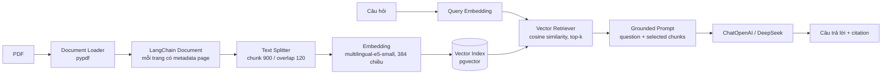
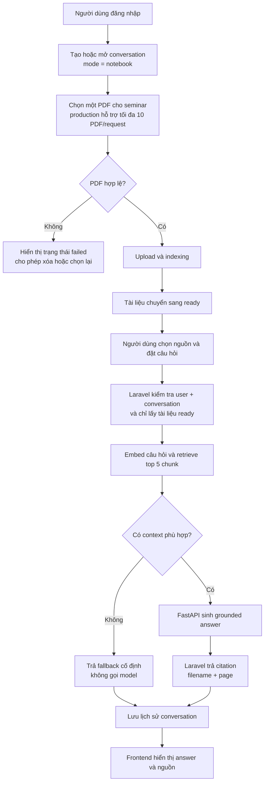
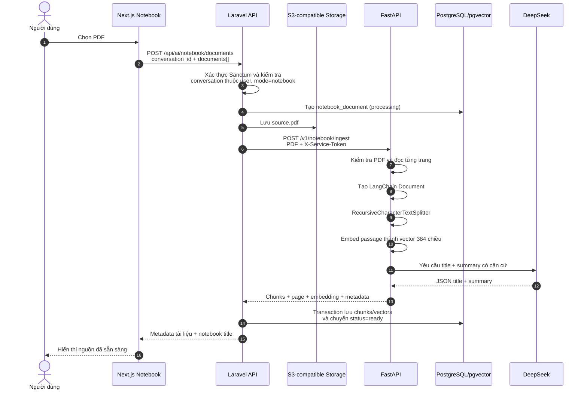
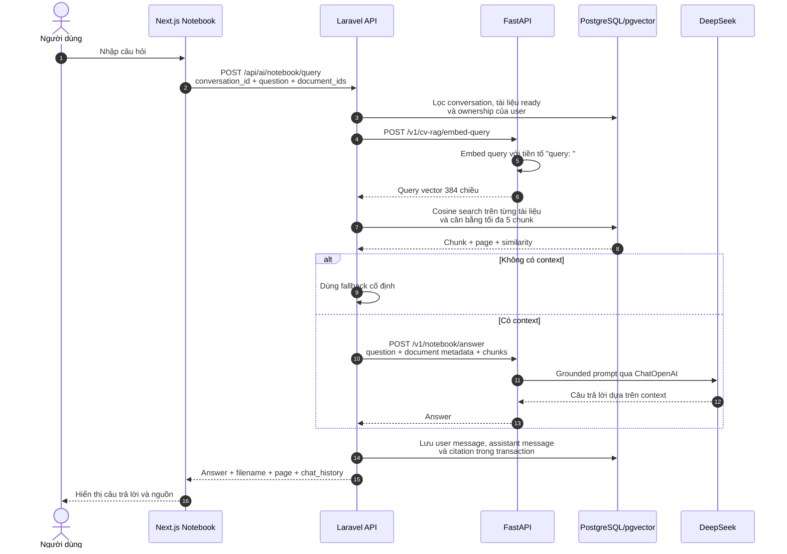

# AI-04 — Notebook Mini-RAG

## Chủ đề seminar

**Xây dựng luồng Hỏi - Đáp trên một tài liệu cụ thể với LangChain và FastAPI**

*Mini-RAG Pipeline: Document Loader → Text Splitter → Embedding → Vector Retriever*

Mục tiêu của seminar là giải thích và trình diễn cách biến một PDF thành nguồn dữ liệu có thể hỏi đáp. Kịch bản dùng **một PDF** để người nghe dễ theo dõi; Notebook thực tế của KnowledgeHub mở rộng cùng nguyên lý cho nhiều PDF trong một conversation.

Sau seminar, người nghe cần hiểu:

1. Vì sao tài liệu phải được chia thành các chunk trước khi tìm kiếm.
2. Embedding biến chunk và câu hỏi thành vector như thế nào.
3. Vector retriever chọn context liên quan trước khi gọi LLM.
4. Grounding và citation giới hạn câu trả lời trong tài liệu ra sao.
5. Pipeline khái niệm khác implementation production hiện tại ở điểm nào.

## Thông điệp kỹ thuật chính

Codebase hiện tại **đã sử dụng LangChain**:

- `langchain_core.documents.Document` biểu diễn từng trang/chunk.
- `RecursiveCharacterTextSplitter` chia văn bản với `chunk_size=900`, `chunk_overlap=120`.
- `ChatOpenAI` gọi model qua API tương thích OpenAI để tạo title, summary và câu trả lời.
- `InMemoryVectorStore` được dùng trong test để minh họa semantic retriever.

Production không bắt buộc mọi tầng đều dùng abstraction của LangChain. `pypdf` đang đọc PDF, embedding dùng `sentence-transformers`, còn Laravel thực hiện vector retrieval trực tiếp trên PostgreSQL/pgvector để giữ authorization và quyền sở hữu dữ liệu ở backend.

## Pipeline dùng trong seminar

Một PDF là trường hợp đơn giản nhất của Notebook nhiều nguồn:

Pipeline có hai pha:

- **Indexing:** đọc PDF, chia chunk, tạo embedding và lưu vector.
- **Question answering:** embedding câu hỏi, retrieve chunk gần nhất, dựng prompt và sinh câu trả lời có căn cứ.

## Ánh xạ khái niệm với code hiện tại

| Bước seminar | Implementation hiện tại | Vị trí chính |
| --- | --- | --- |
| Document Loader | `pypdf.PdfReader` đọc PDF thành LangChain `Document` theo từng trang | `ai-service/app/notebook_rag.py` |
| Text Splitter | LangChain `RecursiveCharacterTextSplitter(900, 120)` | `ai-service/app/notebook_rag.py` |
| Embedding tài liệu | `sentence-transformers` với tiền tố `passage: ` | `ai-service/app/cv_rag.py` |
| Vector Index | Vector 384 chiều lưu trong `notebook_document_chunks` | migration tạo bảng Notebook |
| Embedding câu hỏi | Cùng model, dùng tiền tố `query: ` | `POST /v1/cv-rag/embed-query` |
| Vector Retriever | Laravel lọc quyền rồi tìm cosine distance bằng pgvector | `backend/app/Services/AI/NotebookService.php` |
| Grounded generation | LangChain `ChatOpenAI` nhận question và các chunk đã retrieve | `POST /v1/notebook/answer` |
| Citation và lịch sử | Laravel tạo citation và lưu hai message user/assistant | `backend/app/Services/AI/NotebookService.php` |

## Workflow chức năng Notebook

## Sequence diagram — Upload và lập chỉ mục

## Sequence diagram — Hỏi đáp trên tài liệu

## Kịch bản trình bày đề xuất

### 1. Đặt vấn đề — 2 phút

LLM không tự biết nội dung của PDF vừa được tải lên. Nếu gửi toàn bộ tài liệu vào prompt, chi phí và độ nhiễu tăng theo độ dài. Mini-RAG giải quyết bằng cách chỉ đưa các đoạn liên quan nhất vào context.

> “Thay vì yêu cầu mô hình đọc lại cả tài liệu cho mỗi câu hỏi, chúng ta lập chỉ mục một lần, sau đó tìm đúng đoạn cần dùng.”

### 2. Document Loader — 2 phút

- Nhận PDF dạng text, tối đa 15 MB và 100 trang trong Notebook production.
- Kiểm tra magic header, PDF mã hóa, số trang và khả năng trích text.
- Mỗi trang trở thành một LangChain `Document` với metadata `page` bắt đầu từ 1.
- PDF scan-only chưa có OCR nên bị từ chối với `pdf_no_text`.

### 3. Text Splitter — 3 phút

- Dùng `RecursiveCharacterTextSplitter`.
- `chunk_size=900` giữ mỗi đoạn đủ ngắn cho retrieval và prompt.
- `chunk_overlap=120` tránh mất ý ở ranh giới hai chunk.
- Metadata trang được giữ lại để tạo citation.
- Một tài liệu Notebook có tối đa 300 chunk.

### 4. Embedding — 3 phút

- Model: `intfloat/multilingual-e5-small`.
- Revision được pin; vector đầu ra có đúng 384 chiều và được normalize.
- Chunk dùng tiền tố `passage: `, câu hỏi dùng `query: ` theo cách dùng E5.
- Vector thể hiện gần nghĩa, không chỉ trùng từ khóa.

### 5. Vector Retriever — 3 phút

- Laravel chỉ chọn tài liệu `ready` thuộc conversation của user hiện tại trước khi search.
- PostgreSQL/pgvector sắp xếp theo cosine distance bằng toán tử `<=>`.
- Với nhiều nguồn, implementation lấy chunk tốt nhất của mỗi tài liệu trước, sau đó bổ sung theo similarity đến giới hạn 5 chunk.
- Với seminar một PDF, đây tương đương lấy top-k chunk gần câu hỏi nhất.

### 6. Grounded answer — 3 phút

- FastAPI nhận câu hỏi và chỉ các chunk đã retrieve, không nhận quyền truy cập DB.
- LangChain `ChatOpenAI` gửi grounded prompt tới DeepSeek.
- Nội dung PDF và câu hỏi được coi là untrusted data, không phải system instruction.
- Nếu context rỗng, hệ thống trả `Không tìm thấy thông tin trong tài liệu đã chọn.` mà không gọi model.
- Laravel tạo citation từ chunk thực tế và lưu cùng lịch sử hội thoại.

### 7. Demo — 5 phút

1. Mở `/ai/companion?mode=notebook` và tạo một Notebook mới.
2. Upload một PDF text-based ngắn, đợi trạng thái `ready`.
3. Chỉ vào title, summary và số chunk để giải thích pha indexing.
4. Hỏi một câu có câu trả lời trực tiếp trong PDF.
5. Kiểm tra câu trả lời, tên file và số trang.
6. Hỏi lại bằng cách diễn đạt khác để minh họa semantic retrieval.
7. Hỏi một thông tin không có trong PDF để minh họa fallback và chống hallucination.

Ba câu hỏi mẫu:

| Mục đích | Câu hỏi |
| --- | --- |
| Có bằng chứng trực tiếp | “Tài liệu định nghĩa khái niệm chính như thế nào?” |
| Paraphrase | “Hãy diễn giải lại kết luận quan trọng nhất bằng từ ngữ khác.” |
| Ngoài tài liệu | “Tài liệu này dự đoán thời tiết ngày mai ra sao?” |

## Khác biệt giữa seminar và codebase hiện tại

| Nội dung | Kịch bản seminar | Notebook production hiện tại |
| --- | --- | --- |
| Số nguồn | Một PDF để dễ quan sát | Nhiều PDF trong một Notebook conversation |
| LangChain | Nhấn mạnh `Document`, splitter và model interface | Dùng LangChain ở các phần này trong FastAPI |
| PDF loader | Gọi theo vai trò “Document Loader” | Dùng trực tiếp `pypdf`, chưa dùng `PyPDFLoader` |
| Embedding | Một bước trong pipeline LangChain/RAG | `sentence-transformers` qua helper nội bộ, không dùng LangChain Embeddings class |
| Retriever | Trình bày như Vector Retriever | Laravel query PostgreSQL/pgvector, không dùng LangChain Retriever class |
| Vector store | Có thể minh họa bằng in-memory store | Vector được lưu bền vững trong PostgreSQL |
| Authorization | Có thể lược giản khi giải thích thuật toán | Sanctum, user ownership và conversation scope bắt buộc |
| Lịch sử | Tập trung một lượt hỏi–đáp | Lưu user/assistant messages và citation theo conversation |
| Trang `/seminar-demo` | Không phải luồng Notebook | Hiện đối chiếu keyword RAG-lite và CV-RAG, không gọi Notebook API |

Điểm cần nói rõ với người nghe:

> “LangChain được dùng để chuẩn hóa document, splitting và model interaction. KnowledgeHub chủ động để Laravel và PostgreSQL đảm nhiệm retrieval production nhằm giữ authorization gần dữ liệu. Đây là kiến trúc hybrid, không phải pipeline thiếu LangChain.”

## API cho giao diện

| API | Payload hoặc mục đích |
| --- | --- |
| `GET /api/ai/notebook/documents?conversation_id={id}` | Danh sách tài liệu của Notebook conversation hiện tại. |
| `POST /api/ai/notebook/documents` | Multipart gồm `conversation_id` và tối đa 10 `documents[]`. |
| `GET /api/ai/notebook/documents/{id}` | Metadata tài liệu thuộc user hiện tại. |
| `DELETE /api/ai/notebook/documents/{id}` | Xóa object Storage, document và chunks cascade. |
| `POST /api/ai/notebook/query` | JSON gồm `conversation_id`, `question`, `document_ids`. |

Response query gồm `answer`, `citations`, `chat_history` và `conversation_title`. Mỗi citation có `document_id`, `filename` và `page`.

## Giới hạn và ranh giới tin cậy

- API Laravel yêu cầu Sanctum; FastAPI yêu cầu `X-Service-Token` nội bộ.
- Conversation phải thuộc user hiện tại và có `mode=notebook`.
- Retrieval chỉ dùng tài liệu `ready` trong conversation đã chọn.
- PDF tối đa 15 MB, 1–100 trang, có text trích được và tối đa 300 chunk.
- PDF gốc nằm trên disk S3-compatible `notebook`, bucket mặc định `notebook-docs`.
- PostgreSQL lưu metadata, chunk, page, content hash và vector 384 chiều.
- PDF text, metadata và câu hỏi đều là untrusted data; không được coi là instruction.
- Service token, API key và nội dung riêng tư không được trả về frontend hoặc ghi vào log.
- Xóa document sẽ xóa Storage object trước, sau đó xóa record và cascade chunks.

## Checklist trước seminar

- [ ] AI service và Laravel API đang chạy.
- [ ] `AI_SERVICE_TOKEN`, embedding runtime và model provider được cấu hình.
- [ ] Có một PDF text-based, không chứa dữ liệu cá nhân hoặc bí mật.
- [ ] User demo đã đăng nhập và tạo conversation `mode=notebook`.
- [ ] PDF chuyển sang `ready` và có `chunk_count > 0`.
- [ ] Câu hỏi trực tiếp trả citation đúng trang.
- [ ] Câu hỏi paraphrase vẫn retrieve đúng nội dung.
- [ ] Câu hỏi ngoài tài liệu trả fallback thay vì bịa thông tin.
- [ ] Có phương án trình bày diagram nếu model provider hoặc mạng không khả dụng.

## Tham chiếu code

- `ai-service/app/notebook_rag.py`
- `ai-service/app/cv_rag.py`
- `ai-service/tests/test_notebook_rag.py`
- `backend/app/Services/AI/NotebookService.php`
- `backend/app/Http/Controllers/AI/NotebookDocumentController.php`
- `frontend/src/app/(app)/ai/companion/page.tsx`
- `database/migrations/2026_11_22_000001_create_notebook_documents_tables.php`
- `database/migrations/2026_11_23_000001_separate_notebook_conversations.php`
