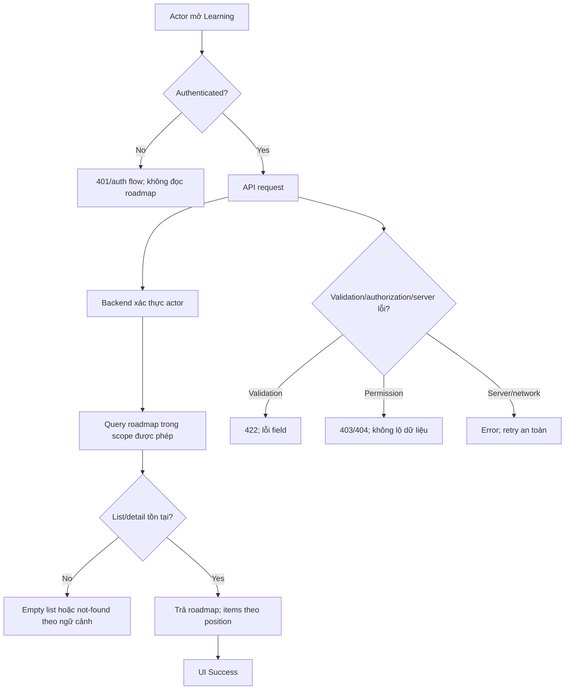

# LRN-001 — Quản lý roadmap học tập

**Nguồn:** `D:\Web\docs\features\learning\LEARN-01-roadmaps.md`  
**Owner:** `TEAM_MEMBER_C`; độ rủi ro: Medium theo ownership, cao hơn ở các quyết định đang chờ.  
**Trạng thái:** Đặc tả evidence-based; API và quy tắc CRUD/state còn cần phê duyệt. Đọc thêm `00-overview.md`.

## 1. Mục tiêu, actor, phạm vi

Cho User tạo và quản lý kế hoạch học do mình sở hữu, gồm các item có thứ tự, có thể liên kết tùy chọn với `articles`. Giải quyết nhu cầu lập kế hoạch; **không** triển khai enrollment hay course-wide progress.

**Actor:** Guest (không truy cập); User (roadmap của chính mình); Contributor (như User trong năng lực học); Admin (quyền truy cập theo chính sách được xác nhận, hiện context pack nói owner/Admin); Content API/source cung cấp article, không phải actor sửa roadmap.

**IN SCOPE:** list/detail/create/update/delete roadmap và item chỉ trong phạm vi sau khi Product duyệt; ownership; schema hiện tại; UI đề xuất; test isolation/order.  
**OUT OF SCOPE:** AI generation (`AI-05` riêng), enrollment, course structure mới, tự động hoàn thành roadmap, quyết định quota, thay đổi Content schema/API, tự thêm migration.

**Tiền điều kiện:** actor authenticated bằng cơ chế được backend xác nhận; migration `000008` áp dụng; user có quyền học.  
**Kết quả:** thay đổi hợp lệ chỉ ảnh hưởng roadmap sở hữu; thứ tự item hợp lệ, không để partial reorder.

## 2. Căn cứ và source map

| Ref | Nội dung |
|---|---|
| R-001 | Roadmap thuộc user; owner/Admin đọc/sửa; Guest không truy cập — `LEARN-01`, `context-packs/learning.md` (CONFIRMED) |
| R-002 | Roadmap status: `active`, `completed`, `archived`, `paused` — migration check (CONFIRMED tập giá trị, không phải transition) |
| R-003 | Item `pending`, `in_progress`, `completed`, `skipped`; vị trí unique trong roadmap — migration (CONFIRMED) |
| R-004 | `article_id` optional; FK `SET NULL` — migration (CONFIRMED) |
| R-005 | CRUD/transition/quota/article visibility/reorder/delete semantics chưa duyệt — `LEARN-01` (OPEN QUESTION) |
| S-001 | `database/migrations/2026_01_01_000008_create_learning_roadmap_tables.php` |
| S-002 | `backend/AGENTS.md`, `backend/routes/api.php`, `backend/routes/api/content.php` (routing patterns; backend Learning app absent) |
| S-003 | `frontend/src/lib/api.ts`, `frontend/src/app/(app)/layout.tsx`, `frontend/src/app/(app)/courses/page.tsx` (client/UI pattern) |
| S-004 | `docs/API.md`, `docs/DATABASE.md`, `docs/ERD.md`, `docs/team/context-packs/learning.md` |

## 3. Business rules

| ID | Điều kiện → hành vi/kết quả | Ngoại lệ | Trạng thái |
|---|---|---|---|
| BR-001 | Mọi read/write roadmap phải kiểm tra actor; chỉ owner hoặc capability Admin được duyệt mới được tiếp tục. | Guest → unauthenticated; ID roadmap của user khác → từ chối, không trả dữ liệu. | CONFIRMED, capability Admin chi tiết OPEN QUESTION |
| BR-002 | `user_id` của roadmap lấy từ authenticated actor, không nhận từ payload client. | Không cho client chuyển owner qua update. | CONFIRMED từ ownership/security requirement; implementation phải enforce server-side |
| BR-003 | `roadmap_items.position` duy nhất theo `roadmap_id`. Create/reorder phải tránh duplicate và trạng thái reorder nửa chừng. | Vi phạm constraint → rollback, không báo success. | CONFIRMED schema; algorithm/transaction bắt buộc theo context pack |
| BR-004 | Roadmap status chỉ nhận bốn giá trị trong CHECK. | Giá trị ngoài enum → validation 422 trước DB; DB CHECK vẫn là lớp bảo vệ. | CONFIRMED tập giá trị; transition matrix OPEN QUESTION |
| BR-005 | Item status chỉ nhận bốn giá trị trong CHECK. | Không suy ra transition chỉ từ tập giá trị. | CONFIRMED tập giá trị |
| BR-006 | `article_id` nullable; xóa article vật lý làm FK thành NULL, item vẫn tồn tại. | Soft-delete/archived/published visibility behavior chưa được quy định. | CONFIRMED schema; cách hiển thị OPEN QUESTION |
| BR-007 | User không được đọc/sửa roadmap/item của người khác bằng cách thay UUID. Ownership kiểm tra xuyên item→roadmap. | 404 vs 403 cần contract quyết định; không tiết lộ resource. | CONFIRMED security invariant |
| BR-008 | Empty roadmap, số roadmap tối đa, độ dài `title`/`goal`, delete semantics, state transitions không được tự suy diễn. | Block triển khai hành vi tương ứng đến khi được Product duyệt. | OPEN QUESTION |

### State

DB cho phép roadmap `active|completed|archived|paused`; item `pending|in_progress|completed|skipped`. **Không có transition nào được feature source xác nhận.** Không tự thêm state machine cho create/update/archive, cũng không auto-complete roadmap. Quyết định chuyển trạng thái khi state hiện tại cấm hành động cần OQ-02 trong overview.

## 4. Luồng nghiệp vụ và sơ đồ

### 4.1 Luồng list/detail

1. User mở khu vực Learning; UI bắt đầu Initial rồi Loading; chưa có route Learning hiện tại (ASSUMPTION: UI mới).
2. Client gọi endpoint đề xuất, gửi auth theo cơ chế được xác nhận; không dùng content mock fallback.
3. Backend xác thực; Guest bị từ chối. Query chỉ lấy roadmap của actor; nếu cho Admin truy cập roadmap khác, capability phải được policy xác định trước.
4. Detail: tìm roadmap theo ID trong tập được phép; load items theo `position`; không query item theo ID mà bỏ qua roadmap ownership.
5. Thành công: list có data → Success; list rỗng → Empty; detail không tìm thấy/không được phép → xử lý không tiết lộ existence theo error contract.
6. Network/server error → Error, giữ retry; không hiển thị dữ liệu cache thuộc actor khác.

### 4.2 Luồng create/update roadmap và items (chỉ sau khi duyệt contract)

1. Actor mở form; Initial có giá trị create rỗng; update khởi tạo từ response detail.
2. UI validate required/format chỉ theo các bounds được Product duyệt; submit chuyển Pending, disable nút để tránh double submit.
3. Request không gửi `user_id`; backend authenticate → Policy → Form Request → Service.
4. Service validate roadmap state, article references, ownership và item positions; các quy tắc article còn OPEN QUESTION.
5. Nếu thay đổi nhiều bản ghi (roadmap + items/reorder), ghi trong transaction; unique `(roadmap_id, position)` là constraint cuối. Thất bại bất kỳ bước nào rollback toàn bộ.
6. Success trả representation theo contract đã duyệt; UI cập nhật từ response, success message; không giả định envelope cụ thể trước khi duyệt.
7. 422 hiển thị lỗi cạnh field; 401 chuyển sang auth/session flow đã có; 403/404 không reveal data; 5xx/network giữ form và cho retry sau khi xác nhận operation outcome.
8. Refresh/back khi request pending: không tạo thêm request tự động; create retry idempotency chưa có contract nên cần xử lý trạng thái không chắc chắn bằng reload/list, không hứa dedupe server-side.

### 4.3 Luồng xóa roadmap/item và reorder

Hành vi chưa đủ căn cứ để chốt confirmation dialog, restore, delete hay reorder API. **Blocker:** Product quyết định delete semantics, cascade đã biết là roadmap→items→progress/prerequisite edges, và item deletion→progress/edge cascades; quyết định reorder payload/algorithm. Sau phê duyệt, mọi multi-row delete/reorder là atomic, kiểm tra owner, xử lý unique collision/concurrent edits, UI chỉ cập nhật sau success. Không triển khai route/hành vi từ sơ đồ đề xuất trước khi contract duyệt.

## 5. UI đề xuất (ASSUMPTION, cần product/design xác nhận)

| Khu vực | Nội dung/hành vi | Trạng thái |
|---|---|---|
| Learning list | Danh sách roadmap của actor; CTA tạo nếu quyền/flow được duyệt; không render Admin data tùy tiện | Initial/Loading/Success/Empty/Error |
| Roadmap form | `title`, `goal`; item title/description/article link/position nếu CRUD item được duyệt. Label/placeholder/copy chưa có design source | Initial/Editing/Pending/Validation error/Server error/Success |
| Roadmap detail | Status, mục tiêu, item theo `position`; điều khiển state/reorder/delete chỉ hiện theo policy/transition đã duyệt | Loading/Success/Empty/Error/Unavailable |

Không có field label/placeholder hoặc thiết kế nút được yêu cầu xác nhận. Không tạo flow Admin override trong UI trước OQ-03. Form server errors đặt cạnh field nếu 422 có field errors; lỗi tổng thể có vùng thông báo form và retry/reload theo loại lỗi.

## 6. Dữ liệu và validation

### Schema hiện tại

`learning_roadmaps(id UUID PK, user_id UUID FK users RESTRICT, title VARCHAR, goal TEXT, status VARCHAR(20) DEFAULT active CHECK, created_at/updated_at TIMESTAMPTZ nullable)`; index `user_id`.  
`roadmap_items(id UUID PK, roadmap_id UUID FK CASCADE, article_id UUID nullable FK articles SET NULL, title VARCHAR, description TEXT nullable, position UNSIGNED SMALLINT, status VARCHAR(20) DEFAULT pending CHECK, timestamps nullable)`; unique `(roadmap_id, position)`, indexes `roadmap_id`, `article_id`.

| Field | Kiểu | Bắt buộc | Validation/normalize | Biên | Nguồn |
|---|---|---:|---|---|---|
| `title` roadmap | string | DB NOT NULL | Client/server trim/empty rule cần duyệt; không có length limit xác nhận | VARCHAR mặc định migration; limit DB thực tế phụ thuộc driver | migration; bounds OPEN QUESTION |
| `goal` | text | DB NOT NULL | Empty/length rule chưa xác nhận | TEXT | migration |
| `status` roadmap | string enum | DB non-null, default `active` | Chỉ 4 giá trị; transition chưa chốt | 20 chars | migration |
| `user_id` | UUID | DB NOT NULL/FK | Server derive actor; client không được set | UUID hợp lệ, user phải tồn tại | migration + R-001 |
| `title` item | string | DB NOT NULL | trim/length chưa xác nhận | VARCHAR | migration |
| `description` | text | Không | nullable; length chưa xác nhận | NULL cho phép | migration |
| `position` | unsigned small integer | DB NOT NULL | integer không âm; unique theo roadmap | dải unsigned small integer theo DB/migration; số bắt đầu 0 hay 1 chưa chốt | migration |
| `article_id` | UUID nullable | Không | tồn tại + visibility policy cần Content contract | null hợp lệ | migration |
| `status` item | string enum | DB non-null, default `pending` | 4 giá trị CHECK; transition không suy ra | 20 chars | migration |

Không có pagination/sort API đã được duyệt. Ordering hiện có duy nhất là `position`. Article soft-delete không kích hoạt FK SET NULL; cách hiển thị article soft-deleted cần Content owner xác nhận.

## 7. API và database

**API hiện tại:** không có Learning endpoint. Mọi ví dụ dưới là **PROPOSED, không được coi là approved contract**. Candidate shape chỉ để nêu phạm vi cần quyết định: `GET /learning/roadmaps`, `POST /learning/roadmaps`, `GET|PUT|DELETE /learning/roadmaps/{roadmap}`; endpoint item riêng hay nested chưa quyết định. Không dùng HTTP route trước approval.

Authentication backend mechanism, exact path/base URL, response/error status, field errors, pagination, idempotency đều TBD. Nếu REST được duyệt, theo convention Laravel route group/auth middleware, thin controller→Policy/Form Request→Service, envelope API project sau khi contract thống nhất. Ví dụ payload không đưa ra để tránh đóng giả schema contract.

**Database:** không cần migration theo yêu cầu/schema hiện tại. Create roadmap đơn có thể atomic một insert; roadmap+items, reorder nhiều item, delete cascade cần transaction/atomic behavior. Unique position chịu race nhưng transaction/locking strategy cho reorder phải được xác nhận. `roadmap_id` owner scope bắt buộc cho every item mutation. Không update migration cũ.

## 8. Ma trận lỗi/biên

| ID | Tình huống | Nơi | Hành vi | UI/response | Retry? |
|---|---|---|---|---|---|
| E-01 | Guest | Backend auth | Không query/write | 401 theo contract/auth flow | Sau đăng nhập |
| E-02 | UUID roadmap/item thuộc user khác | Policy/query scope | Từ chối; không lộ dữ liệu | 403 hoặc 404 cần contract; UI không hiển thị resource | Không |
| E-03 | Thiếu/invalid title, status | Form Request + DB CHECK | Từ chối trước write; CHECK là guard | 422 field errors | Sau sửa |
| E-04 | Article ID không tồn tại / không đủ visibility | Service + Content boundary | Rollback write | 422/404 theo contract được duyệt | Không cho tới khi sửa ID/quyền |
| E-05 | Position collision | DB unique + service transaction | Rollback mọi thay đổi trong reorder | Conflict/422 theo contract; reload state | Sau reload/reorder |
| E-06 | Article bị xóa vật lý giữa read/write | FK `SET NULL` | Item tồn tại với `article_id=NULL` nếu delete thắng; logic version/visibility TBD | Render item không có linked article | Có thể refresh |
| E-07 | Request trùng/double submit | UI pending; backend contract chưa có idempotency | Disable nút; không tuyên bố server dedupe | Reload list/detail nếu kết quả mơ hồ | Có kiểm tra trước |
| E-08 | Network/5xx/DB lỗi | Client/backend | Không render success; transaction rollback khi write DB failure | Error + retry/reload, giữ draft UI | Có điều kiện |
| E-09 | Status transition không hợp lệ / archived edit | Chưa có rule | Không triển khai cho tới khi transition matrix duyệt | N/A | Blocker |

## 9. Bảo mật, vận hành, hiệu năng

- Backend derive `user_id`; Policy kiểm tra roadmap owner/Admin; nested item query scoped tới roadmap đã authorize; reject mass assignment `user_id`, status/field ngoài allowlist.
- Không dùng client cache/mock data thay quyền; không đưa `goal`/private roadmap vào log. Không tiết lộ foreign resource qua response.
- Query list scoped theo indexed `user_id`; items order theo unique `(roadmap_id,position)`. Pagination/quota chưa có căn cứ; cần duyệt nếu số lượng lớn.
- Multi-step write transaction. Log correlation/error class, không log nội dung goal. Không có cache/monitoring Learning hiện hữu.

## 10. Acceptance criteria và test matrix

| AC | Given / When / Then | Req |
|---|---|---|
| AC-01 | Given User A và roadmap của A, When A list/detail, Then chỉ dữ liệu thuộc A xuất hiện và items theo `position` | R-001 |
| AC-02 | Given Guest, When gọi read/write roadmap, Then backend từ chối trước khi đọc/ghi | R-001 |
| AC-03 | Given User B biết UUID roadmap/item của A, When truy cập/sửa, Then backend không trả dữ liệu hay ghi thay đổi | R-001 |
| AC-04 | Given payload có `user_id` giả mạo, When tạo/update, Then owner vẫn actor hoặc request bị reject; không chuyển ownership | R-001 |
| AC-05 | Given position hợp lệ, When lưu items, Then cùng roadmap không có position trùng | R-003 |
| AC-06 | Given reorder làm trùng position hoặc DB failure, When ghi nhiều items, Then transaction rollback toàn bộ | R-003 |
| AC-07 | Given article vật lý bị xóa, When FK action chạy, Then item còn và `article_id` null | R-004 |
| AC-08 | Given request thiếu status transition decision, When triển khai, Then implementation không tự thêm auto-complete/archive semantics | R-005 |

| Test ID | Req | Loại | Tiền điều kiện/action | Expected | Mức |
|---|---|---|---|---|---|
| T-01 | R-001 | Feature/API | User A list/detail roadmap A; có B | Chỉ A | Integration |
| T-02 | R-001 | Feature/API | Guest GET/POST | 401/no DB write | Integration |
| T-03 | R-001 | Feature/API | User B GET/PUT/DELETE foreign UUID | denied/no leak/no write | Integration |
| T-04 | R-001 | Feature/API | POST spoof `user_id` | owner derive hoặc reject | Integration |
| T-05 | R-002 | Unit/Feature | status ngoài CHECK | validation fail; DB invariant intact | Unit+Integration |
| T-06 | R-003 | Feature/DB | duplicate `(roadmap_id,position)` | reject; unique remains | Integration |
| T-07 | R-003 | Feature | reorder đa item; inject lỗi giữa write | transaction rollback | Integration |
| T-08 | R-004 | DB integration | delete article vật lý có FK | item link null, item tồn tại | Integration |
| T-09 | R-005 | Regression | roadmap paused/completed/archived | chỉ transition đã duyệt được phép | Integration, blocked until OQ-02 |

Mở rộng `backend/tests/Feature/Learning/**`, `backend/tests/Unit/Learning/**`; convention PHPUnit/Laravel theo `backend/tests/Feature/Content/ArticleTest.php`. Chạy bằng `docker compose exec app php artisan test`; đã xác minh ngày 2026-10-22: 41 test pass (137 assertions) cho toàn bộ suite backend.

## 11. Ánh xạ source và triển khai

| File/module | Hiện trạng | Thay đổi dự kiến | Req |
|---|---|---|---|
| Migration `000008` | Schema đúng domain | Tái sử dụng; không sửa | R-002–004 |
| `routes/api.php` | Shared registry, đã include Learning domain | Không cần thay đổi thêm | R-001 |
| `routes/api/learning.php` | Đã có: 5 route roadmap + 3 route item | Duy trì; bổ sung khi contract mới được duyệt | R-001 |
| Learning Controller/Requests/Models/Policy/Services | Đã có đầy đủ theo backend conventions | Duy trì; Policy đăng ký qua `Gate::policy` trong `AppServiceProvider` | R-001–004 |
| `frontend/src/lib/api.ts` | Generic fetch/Bearer client | Reuse; không đổi auth global mặc định | R-001 |
| Learning page/components | Đã có trang list/create/delete roadmap; chưa có UI item | Bổ sung UI item sau UI/API approval | R-001 |
| Learning Feature/Unit tests | Đã có 4 file test | Mở rộng khi có rule mới | R-001–004 |
| `docs/API.md` | Learning: 12 route IMPLEMENTED, v0.4 | Cập nhật khi contract thay đổi | API |

### Task plan (thực hiện sau khi unblock)

| Task | Mục tiêu/dependency | Files dự kiến | Steps / output | Test; DONE |
|---|---|---|---|---|
| LRN-001-T0 | Chốt OQ-01–05, OQ-08; trước code | Chỉ docs/API.md khi contract approved; ngoài task hiện tại | Duyệt CRUD/state/article/auth/API contract; không thay schema tùy tiện | Contract review; DONE khi decisions có owner/approval |
| LRN-001-T1 | Read/model/policy; T0 + Laravel bootstrap | Learning Models/Policy/Services | Scope owner, UUID relationships, validate item parent | Unit/feature ownership; DONE khi isolation tests pass |
| LRN-001-T2 | CRUD API; T1 | Learning Requests/Controllers, `routes/api/learning.php`, registry coordination | List/detail/create/update theo contract, transaction | Feature RBAC/validation; DONE contract tests pass |
| LRN-001-T3 | UI; T0/T2 | `frontend/src/app/(app)/learning/**`, `components/learning/**` | list/detail/form states, use `api.ts`, no mock fallback | Component/e2e; DONE AC-01–08 cover |

**Blockers:** OQ-01, OQ-02, OQ-03, OQ-04, OQ-08. OQ-05 đã chốt ngày 2026-10-22 (`learning_progress.status` là authority, `roadmap_items.status` là mirror; xem ADR `2026-10-22-learning-progress-authority.md`). Những phần khác không được coi là đã quyết định.

## 12. Assumptions, open questions, blockers

- **ASSUMPTION A-01:** authenticated actor dùng UI page `/learning`; nơi đặt route chỉ đề xuất, không phải URL đã duyệt.
- **OPEN QUESTION OQ-01:** CRUD item/reorder/empty/quota/field limits; ảnh hưởng API/UI/DB.
- **OPEN QUESTION OQ-02:** state transition, archive edit, auto-complete; blocker business correctness.
- **OPEN QUESTION OQ-03:** Admin có quyền visibility/manage toàn cục đến đâu; blocker security.
- **OPEN QUESTION OQ-04:** article published/archived/soft-deleted/version behavior; blocker cross-domain, cần Content owner.
- **IMPLEMENTATION BLOCKER:** không mở rộng state-changing/API behavior ngoài contract hiện hành trước khi OQ-01–04 + OQ-08 được duyệt; không tự tạo migration hay thay Content model.
