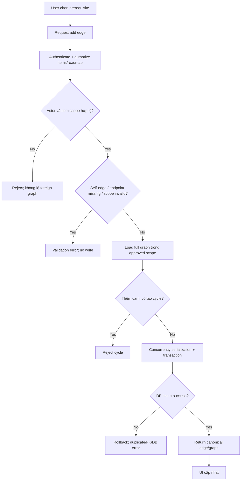

# LRN-003 — Điều kiện tiên quyết giữa roadmap items

**Nguồn:** `D:\Web\docs\features\learning\LEARN-03-prerequisites.md`  
**Owner:** `TEAM_MEMBER_C`; risk cao do graph cycle và concurrency. Đọc `00-overview.md`.

## 1. Mục tiêu, phạm vi, actor

Biểu diễn quan hệ prerequisite giữa các `roadmap_items` bằng cạnh có hướng trong `roadmap_item_prerequisites`, giữ graph không có self-edge/cycle. User quản lý edges trong roadmap mà mình được phép; Admin scope cần xác nhận.

**IN SCOPE:** add/remove edge theo contract sau khi duyệt scope; validate endpoints/ownership; full-graph cycle prevention; transaction/concurrency safety; UI graph/list control và tests.  
**OUT OF SCOPE:** prerequisite giữa roadmap hay không (chưa quyết); semantics completed/skipped/unlock; enforcement chặn mở item; tự đổi progress; AI; schema change không duyệt.

**Tiền điều kiện:** hai item tồn tại và actor được authorize roadmap scope; migration `000008`.  
**Kết quả:** graph không self-reference, không cycle; edge chỉ trong scope đã duyệt; mutation atomic.

## 2. Căn cứ, code map

| ID | Căn cứ | Trạng thái |
|---|---|---|
| R-201 | `roadmap_item_prerequisites` composite PK `(roadmap_item_id, prerequisite_item_id)`, cả FK cascade, index prerequisite endpoint | CONFIRMED migration |
| R-202 | DB CHECK cấm `roadmap_item_id = prerequisite_item_id`; DB không phát hiện indirect cycle | CONFIRMED migration + `docs/DATABASE.md` |
| R-203 | Service phải validate full graph trước ghi | CONFIRMED context pack/DB docs |
| R-204 | Roadmap owner/Admin authorization | CONFIRMED context pack, Admin scope detail TBD |
| R-205 | Same-roadmap vs cross-roadmap; completed/skipped meaning; in-progress edge edits; item delete behavior; concurrent serialization chưa duyệt | OPEN QUESTION source |
| S-201 | `database/migrations/2026_01_01_000008_create_learning_roadmap_tables.php` |
| S-202 | `docs/DATABASE.md`, `docs/ERD.md`, `docs/team/context-packs/learning.md` |
| S-203 | `backend/AGENTS.md`; Learning service/routes/tests chưa tracked |
| S-204 | `frontend/src/lib/api.ts`; UI Learning chưa tồn tại |

## 3. Quy tắc nghiệp vụ

| ID | Quy tắc | Ngoại lệ | Trạng thái |
|---|---|---|---|
| BR-201 | Mọi add/remove edge authorize actor qua item→roadmap trước query/mutation. | Foreign owner/Guest bị từ chối; không lộ graph. | CONFIRMED |
| BR-202 | Không cho self-prerequisite. | DB CHECK vẫn là lớp cuối, service trả validation rõ. | CONFIRMED |
| BR-203 | Graph phải là DAG; validate full graph liên quan, bao gồm cả batch edges nếu batch được hỗ trợ. | Cycle dài >1 bị reject, write rollback. | CONFIRMED requirement |
| BR-204 | Duplicate edge không thể tồn tại do composite PK. | Add duplicate response/idempotency semantics chưa chốt. | CONFIRMED schema; API behavior TBD |
| BR-205 | Cả endpoints phải tồn tại; scope same-roadmap/cross-roadmap phải theo quyết định Product. | Không cho phép cross-roadmap mặc định. | OPEN QUESTION; blocker |
| BR-206 | Completed/skipped/in-progress status không tự thay nghĩa graph hoặc availability. | Không chặn item/auto-unlock đến khi semantics duyệt. | OPEN QUESTION; blocker |
| BR-207 | Concurrent mutation phải không tạo cycle; transaction đơn thuần với check-then-write có thể race. | Cần approved serialization/locking/isolation. | CONFIRMED risk, strategy OPEN QUESTION |
| BR-208 | Xóa item cascade xóa edge ở cả hai endpoint theo FK. | API/UI delete item semantics/response kế thừa roadmap spec. | CONFIRMED schema |

### Graph orientation

DB column `roadmap_item_id` và `prerequisite_item_id` được xác nhận. Diễn giải sơ bộ edge prerequisite → dependent khi kiểm tra dependency; API payload/UI direction phải ghi rõ và duyệt để tránh đảo nghĩa. Không có state transition graph hoặc rule “item unlock” đã được duyệt.

## 4. Luồng hoạt động

### 4.1 Add prerequisite (single edge; API chưa có)

1. User mở item dependency editor trong authorized roadmap; UI hiển thị current edges và candidates trong scope được duyệt.
2. User chọn prerequisite; client kiểm tra chỉ là UX: khác item hiện tại, candidate trong scope. Không tin client check để bảo mật/DAG.
3. Client gửi add edge tới API đề xuất; path, verb, payload chưa contract.
4. Backend authenticate; resolve cả hai item + roadmap; Policy kiểm tra user ownership/admin capability; Form Request xác thực UUID.
5. Service kiểm tra existence, scope rule; lấy graph hiện tại trong scope, thêm cạnh vào graph tạm; full reachability/cycle check (nếu target đã reach source theo hướng đã duyệt → reject).
6. Graph check + insert cần concurrency serialization đã duyệt. Ghi edge trong transaction; composite PK/check/FK là lớp cuối. Concurrent request không được cùng pass validation rồi tạo cycle.
7. Success trả graph/edge canonical; UI cập nhật. Duplicate/cycle/foreign scope không làm partial write.
8. Validation/cycle lỗi gắn vào dependency control và giải thích hành động sửa; conflict/stale graph yêu cầu refresh; DB/server/network lỗi không báo success.

### 4.2 Remove prerequisite

1. User chọn remove cạnh trong scope được quyền; UI pending/disable edge action.
2. Backend auth → resolve edge + both items → authorize scope → transaction delete.
3. Nếu edge tồn tại, remove; graph còn lại vẫn DAG. Nếu không tồn tại, trả idempotent success hay 404 là API decision; không bịa.
4. Concurrent add/remove được xử lý theo concurrency contract; UI re-fetch khi stale/conflict.

### 4.3 Batch, item delete, status changes

Feature nguồn không xác nhận batch API hay status-based unlocking. Nếu batch được phê duyệt, validate graph với **toàn bộ batch trước khi ghi**, transaction atomic. Item deletion cascade edge đã xác nhận ở DB; coordinated UI/API response thuộc roadmap task. Thay edge khi item `in_progress` và semantics completed/skipped là blocker; không tạo luồng mở khóa giả định.

## 5. UI states (đề xuất, không có UI hiện tại)

| Vùng | Mục đích/controls | State |
|---|---|---|
| Prerequisite list per item | Hiển thị edge theo hướng có label rõ “yêu cầu hoàn thành trước” chỉ sau semantics được duyệt; remove control theo policy | Initial/Loading/Success/Empty/Error |
| Add prerequisite selector | Chỉ candidates trong approved scope; current item/self candidate disable; không áp cross-roadmap khi chưa duyệt | Loading candidates/Empty/Ready/Validation error/Pending |
| Cycle/conflict feedback | Cụ thể “tạo quan hệ này sẽ tạo vòng lặp” (copy đề xuất), giữ selection; conflict yêu cầu refresh | Error/Conflict → reload |

Không tự ẩn item theo prerequisite/status; không có design system/test framework xác nhận cho component. Server errors đặt ngay dependency editor, retry sau refresh với cycle/stale state.

## 6. Dữ liệu và validation

| Field | Kiểu | Bắt buộc | Validation | Biên | Nguồn |
|---|---|---:|---|---|---|
| `roadmap_item_id` | UUID FK, PK composite | yes | item tồn tại, user authorized; same/cross roadmap theo OQ | không null | migration |
| `prerequisite_item_id` | UUID FK, PK composite | yes | item tồn tại, khác dependent, authorized; không tạo cycle | không null | migration |
| Composite pair | unique PK | yes | duplicate không insert lần hai; response semantics TBD | UUID pair | migration |

DB cascade delete cho cả FK. DB bảo vệ self-reference/duplicate/existence; **không** bảo護 indirect cycle, ownership, same-roadmap. Backend service validate all. Batch/maximum graph size/pagination chưa có căn cứ. UUID normalization/route binding phải consistent.

## 7. API/database

Learning endpoint chưa có; `docs/API.md` inventory 0. Chỉ **PROPOSED**, không phải API contract: nested mutation có thể là `PUT/DELETE /learning/roadmaps/{roadmap}/items/{item}/prerequisites/{prerequisite}` hoặc batch endpoint; chưa chọn path/verb/payload/response/error. Không tạo JSON example vì field names/direction/batch semantics chưa duyệt. Auth, version prefix, error envelope, idempotency đều TBD.

DB hiện có đủ lưu edge; không tự thêm schema. Full graph read + check + write phải bảo đảm atomic/concurrency. Transaction không tự bảo vệ check-then-insert khỏi hai concurrent transaction tạo cycle; cần phương án lock/serialize/isolation được DB/backend owner duyệt trước khi implementation. Không tự thay isolation/database architecture. FK cascade item deletion có thể xóa edge đồng thời; stale endpoint phải reject/rollback.

## 8. Ma trận lỗi

| ID | Tình huống | Điều kiện/nơi | Hành vi | UI/response | Retry? |
|---|---|---|---|---|---|
| E-201 | Guest/foreign owner | Auth/Policy | deny trước graph exposure | 401/403/404 contract; no data leak | Sau auth/không foreign |
| E-202 | Self-edge | Request + DB CHECK | no write | validation error tại selector | Sau chọn khác |
| E-203 | Item không tồn tại/deleted concurrently | lookup/FK | no orphan; rollback | not found/stale; reload | Sau refresh |
| E-204 | Scope roadmap không hợp lệ | Service theo OQ same/cross | reject trước insert | scope-specific validation | Không đến khi chọn scope hợp lệ |
| E-205 | Cycle trực tiếp/gián tiếp dài >2 | Full-graph service | reject; no edge | cycle feedback | Sau đổi graph |
| E-206 | Batch có cycle do nhiều edge mới | Graph validation | reject toàn batch; no partial write | chỉ rõ batch invalid | Sau sửa batch |
| E-207 | Duplicate edge | Composite PK | không duplicate; response idempotency/conflict theo contract | refresh/accepted canonical | An toàn sau contract |
| E-208 | Concurrent requests cùng pass DAG check | Lock/isolation/service | serialization; một request recheck/reject, graph vẫn DAG | conflict, reload | Có sau reload |
| E-209 | DB outage/FK/constraint failure | DB transaction | rollback; surface sanitized error | server error; không báo success | Sau khi service phục hồi, recheck |
| E-210 | Status completed/skipped hoặc edit in progress | Chưa có rule | không tự unlock/chặn hoặc từ chối edge theo suy đoán | unavailable cho tới quyết định | Blocked |

## 9. Bảo mật, hiệu năng, vận hành

- Authenticate và Policy tại backend; authorize **cả hai** item và roadmap trước khi load graph/edge. Client chỉ gửi IDs; service xác minh scope/owner lại.
- Không trả graph ngoài scope; không log private roadmap titles/goal hay toàn graph payload. Record cycle rejection/concurrency conflict dưới dạng metric/log an toàn nếu observability được cấu hình.
- Full graph traversal có thể tốn tài nguyên khi graph lớn; schema không có graph size bound. Đo/query plan trước khi đề xuất cache/index/schema changes; không đặt ngưỡng KPI vô căn cứ.
- Transaction + approved serialization là correctness requirement, không chỉ performance optimization. Retry chỉ sau reload/revalidation, không replay write mù.

## 10. Acceptance criteria và test matrix

| AC | Given / When / Then | Req |
|---|---|---|
| AC-01 | Given authorized distinct items, When add edge không tạo cycle trong approved scope, Then edge tồn tại đúng hướng | R-201/R-203 |
| AC-02 | Given self-edge, When add, Then service từ chối và DB không ghi | R-202 |
| AC-03 | Given graph A→B→C, When add cạnh tạo cycle C→A theo orientation đã duyệt, Then reject, graph unchanged | R-203 |
| AC-04 | Given duplicate pair, When add lần hai, Then không tạo duplicate; response theo contract đã phê duyệt | R-204 |
| AC-05 | Given user không owner hoặc Guest, When đọc/mutate edge, Then denied trước khi reveal graph | R-204 |
| AC-06 | Given two concurrent additions would jointly create cycle, When both execute, Then final graph vẫn DAG; loser revalidates under serialization | R-203/R-205 |
| AC-07 | Given item deleted, When cascade executes, Then edge ở cả endpoint được xóa, không orphan | R-201 |
| AC-08 | Given cross-roadmap semantics chưa duyệt, When implementation bắt đầu, Then cross-roadmap behavior bị chặn, không mặc định cho phép | R-205 |
| AC-09 | Given status semantics chưa duyệt, When item incomplete/skipped, Then không tự chặn/auto-unlock item | R-206 |

| Test ID | Req | Loại | Tiền điều kiện/action | Expected | Mức |
|---|---|---|---|---|---|
| T-201 | R-202 | Unit/DB | self-edge insert/service | service validation + DB CHECK reject | Unit+Integration |
| T-202 | R-203 | Unit | two-node cycle | reject | Unit |
| T-203 | R-203 | Unit | indirect cycle length >2 | reject; graph unchanged | Unit |
| T-204 | R-203 | Unit | batch has cycle only after all new edges | reject batch atomically | Unit+Integration |
| T-205 | R-204 | Feature | User A vs B, Guest | denied/no graph disclosure | Integration |
| T-206 | R-204 | DB/API | duplicate composite pair | one row; deterministic contract behavior | Integration |
| T-207 | R-201 | DB integration | delete item endpoint | cascading edge delete | Integration |
| T-208 | R-203/R-205 | Concurrent integration | two transactions whose combined edges form cycle | serialized/rechecked, final DAG | Integration; mandatory blocker |
| T-209 | R-205 | Feature | cross-roadmap items | expected policy after decision | Blocked until OQ-06 |
| T-210 | R-206 | Feature | add/remove edge on in-progress item; skipped prerequisite | exact approved semantics | Blocked until OQ-06 |

Backend tests theo `backend/tests/Unit/Learning/**`, `backend/tests/Feature/Learning/**`; test concurrency dùng DB PostgreSQL runtime, không chỉ SQLite nếu semantics khóa khác nhau. Không thêm test dependency. Command project docs: `docker compose exec app php artisan test`; runtime chưa được thực thi/xác minh.

## 11. Source mapping và implementation plan

| File/module | Hiện trạng | Thay đổi dự kiến | Req |
|---|---|---|---|
| Migration `000008` | Schema edge/check/FK/PK hiện hữu | Reuse, không sửa | R-201/202/204 |
| `RoadmapItem` relationship/model | Chưa tracked | Thêm relationship khi bootstrap/task approved | R-201 |
| `Services/Learning/**` graph validator | Chưa tracked | Full graph validation + concurrency strategy approved | R-203/205 |
| `RoadmapPolicy`, Requests, Controller, routes | Chưa tracked | Scoped authorization + edge contract | R-204/205 |
| Learning UI components | Chưa tồn tại | dependency editor sau design/API | R-201/205 |
| `tests/Unit/Learning`, `Feature/Learning` | Chưa tồn tại | DAG, ownership, concurrency, FK tests | R-201–207 |
| `docs/API.md` | Learning 0 endpoint | Cập nhật contract sau approval | API |

| Task | Dependencies | Files dự kiến | Steps/output | Test/DONE |
|---|---|---|---|---|
| LRN-003-T0 | OQ-03/OQ-06/OQ-07/OQ-08; trước code | Decision/API docs sau approval | Chốt edge orientation, same/cross scope, status semantics, duplicate behavior, lock strategy, limits | Product + backend/DB review; DONE có signoff |
| LRN-003-T1 | T0 + bootstrap | Learning graph service/model relationships | Implement pure graph cycle check/full scope loading; add no DB writes before validation | Unit T-201–204 pass |
| LRN-003-T2 | T1 | Learning service/request/controller/routes | Serialize check+write; add/remove transaction; scoped auth | PostgreSQL concurrent tests T-205–208 pass |
| LRN-003-T3 | T2 + approved UX | Learning dependency UI | Display/add/remove states; conflict refresh; no implied unlock | E2E AC-01–09 pass |

## 12. Assumptions, open questions, blockers

- **ASSUMPTION A-201:** field naming suggests directed prerequisite edge; UI/API must explicitly define direction before approval.
- **OPEN QUESTION OQ-06:** prerequisites chỉ trong cùng roadmap hay cross-roadmap; semantics completed/skipped và sửa khi in-progress. Blocker nghiệp vụ + ownership.
- **OPEN QUESTION OQ-07:** strategy chống race condition của graph validation. Blocker kỹ thuật correctness; yêu cầu DB/backend owner duyệt.
- **OPEN QUESTION OQ-08:** auth, routes, response/error contract. Blocker tích hợp.
- **IMPLEMENTATION BLOCKER:** không code edge mutation cho đến khi OQ-06/OQ-07 được giải quyết; không tin transaction đơn lẻ bảo vệ DAG.
